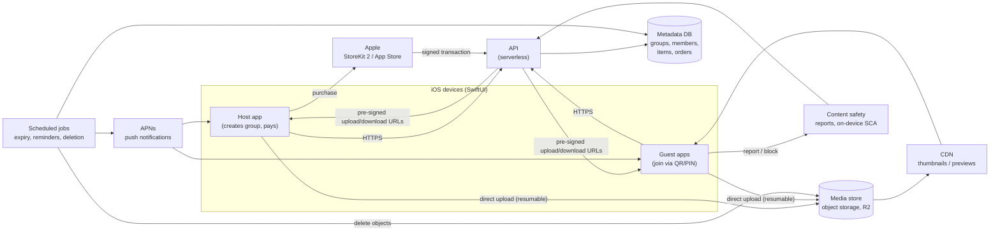
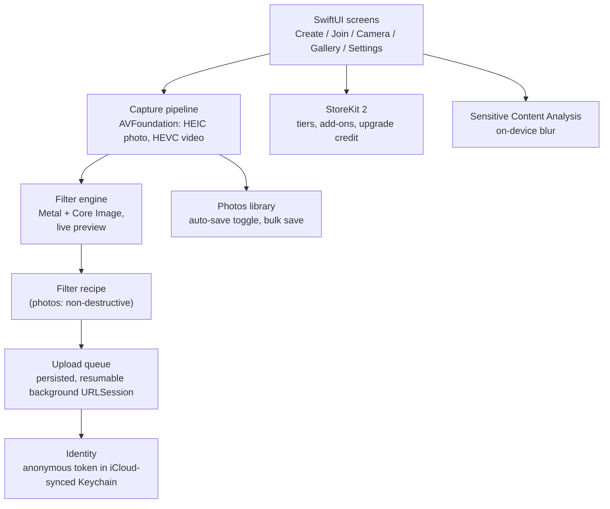
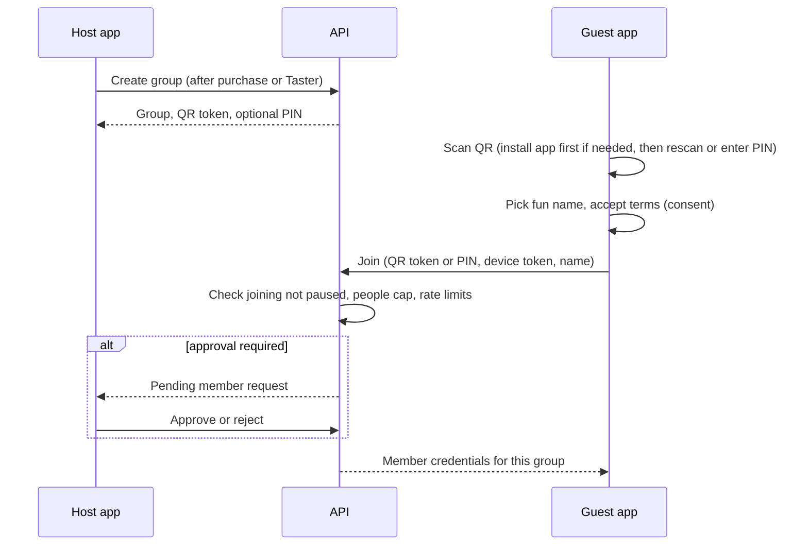
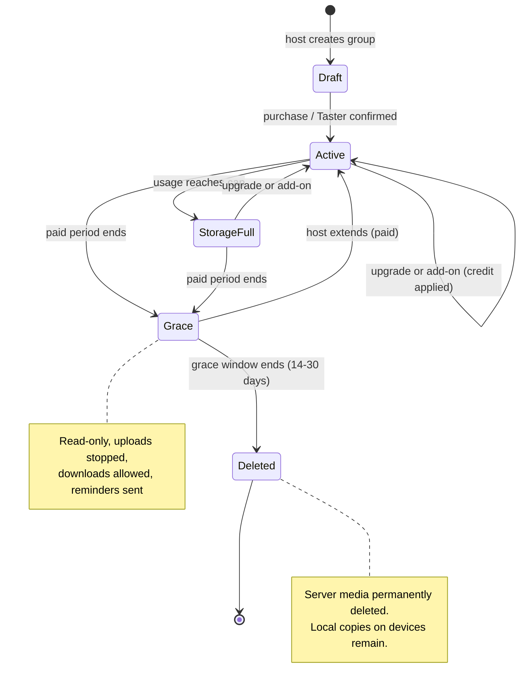

# commonCam: Architecture

Status: draft. Diagrams are Mermaid, which GitHub and most Markdown viewers render.

## 1. Platform choice

Per [COST_MODEL.md](COST_MODEL.md), egress cost makes **Cloudflare R2** the recommended media store. Two deployment options for the rest:

| Option | Components | Trade-off |
|---|---|---|
| **A. All-Cloudflare (recommended for MVP)** | Workers (API), R2 (media), D1 or KV (metadata), Cron Triggers (expiry), Queues | One vendor, one bill, simplest. D1/Workers pricing **not verified** |
| **B. Hybrid** | Azure Functions (API), Azure SQL or Cosmos (metadata), R2 via its S3-compatible API (media) | Fits a team that already knows Azure; two vendors |

The diagrams below are platform-neutral ("API", "Metadata DB", "Media store").

## 2. System context



## 3. On-device structure



## 4. Upload sequence

```mermaid
sequenceDiagram
    participant G as Guest app
    participant A as API
    participant M as Media store
    participant D as Metadata DB

    G->>G: Capture photo/video, apply filter, save to local Photos (if enabled)
    G->>G: Enqueue in persisted upload queue
    G->>A: Request upload URL (group token, device token, size)
    A->>D: Check group active, member allowed, storage cap
    alt cap reached or group expired
        A-->>G: Reject (keep queued up to 24 h, owner notified)
    else allowed
        A-->>G: Pre-signed resumable upload URL
        G->>M: Upload original (background, retries)
        M-->>G: 200 OK
        G->>A: Confirm item (metadata, filter recipe)
        A->>D: Record item, contributor, size; update usage
        A-->>G: Item appears in shared gallery
    end
```

## 5. Join flow



## 6. Group lifecycle



## 7. Data model (sketch)

| Entity | Key fields |
|---|---|
| Group | id, host_device_id, tier, people_cap, storage_cap_bytes, starts_at, ends_at, grace_ends_at, state, joining_paused, approval_required, qr_token, pin (nullable) |
| Member | id, group_id, device_id, display_name, colour, role (host / co-host / guest), status (pending / active / removed / banned) |
| Item | id, group_id, member_id, type, bytes, object_key, created_at, filter_recipe, flagged, hidden |
| Order | id, group_id, apple_transaction_id, sku, amount, credit_applied |
| Report | id, item_id or member_id, reporter_member_id, reason, status |

## 8. Security and privacy notes

- Tokens (QR, PIN) are bearer tokens: random, long (QR), rate-limited, rotatable, and valid only during the paid period. PIN is off by default.
- Media is not publicly listed; access is through short-lived pre-signed URLs scoped to group membership.
- Deletion at the end of grace is enforced by scheduled jobs plus storage lifecycle rules as a backstop.
- Analytics are anonymous and aggregated only, with no ad SDKs.
- Data-protection design (consent wording, minors, retention, subject requests) needs sign-off from Legal and the Data Privacy Officer before launch.

## 9. Open technical questions

- Verified pricing for Workers, D1 and Queues (option A) or Azure Functions (option B).
- Server-side validation of Apple transactions: App Store Server API and notifications handling.
- How the QR token survives the install step (v1: rescan or PIN; later: App Clip).
- Resumable upload mechanics on R2 (multipart with pre-signed parts).
